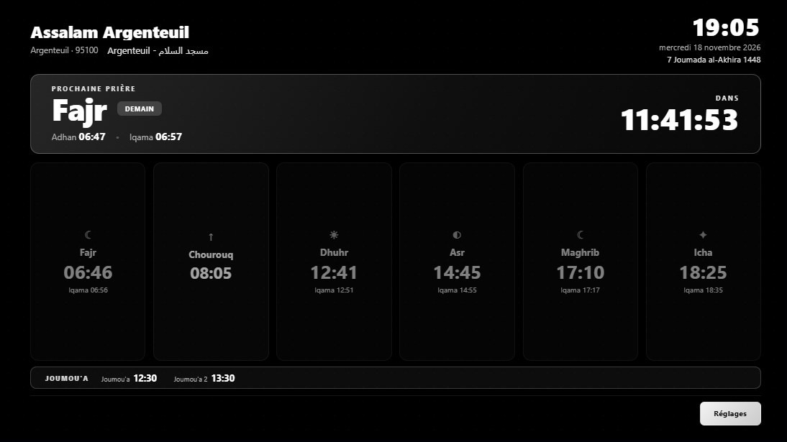

# Mawaqit TV

A standalone prayer-times dashboard for Samsung Tizen TVs, powered directly by your favourite mosque
on [mawaqit.net](https://mawaqit.net).



Pick a country, select your mosque, and the TV displays its official adhan and iqama times,
Jumu'ah schedule, announcements, and the Hijri date. At prayer time, the app plays the Adhan and
takes over the screen with a full-size reminder and countdown. When the app is in the background,
a native Samsung Tizen notification with sound alerts you on your TV screen.

---

## Features

- **100% Standalone (v1.1.0)** – Runs directly on your Samsung TV. No computer, server, or Docker container to run on your local network.
- **Mosque Picker** – Browse 156 countries and search among thousands of mosques by name, city, address, or postal code.
- **TV Dashboard** – Mosque logo and name, mosque-local clock, Gregorian + Hijri dates, next-prayer countdown, six prayer cards (Fajr, Shuruq, Dhuhr, Asr, Maghrib, Isha) and Iqama times.
- **Jumu'ah & Announcements** – Displays up to three Jumu'ah prayer times and an announcement ticker.
- **Adhan & Notifications**:
  - **In foreground**: Full-screen modal takeover with the glowing crescent, mosque name, Iqama countdown, and real Adhan audio playback (`adan.mp3`). Dismiss anytime with **OK** or **BACK**.
  - **In background**: Native Samsung Tizen `StatusNotification` banner with adhan audio, allowing you to be notified while watching TV or using another app.
  - **Pre-alert reminder**: Optional discreet chime and reminder toast 5, 10, or 15 minutes before the adhan.
- **OLED / QLED Burn-in Protection** – Gentle 20-minute Lissajous pixel drift prevents static retention during continuous display.
- **Remote-First UI** – Bespoke 2D spatial navigation for D-pad arrows, Samsung BACK (`10009`), LG Back (`461`), and OK (`13`).
- **Offline Tolerant** – Cached in `localStorage`; mosque timezones and DST transitions are handled internally.
- **Bilingual** – French & English interface (French by default).

---

## Architecture

```text
Samsung Smart TV (tizen-app/)
          │
          │ Direct HTTPS (W3C / Tizen Web App)
          ▼
      mawaqit.net
```

The TV app connects directly to `mawaqit.net`, parses mosque `confData` client-side, computes Iqama offsets and timezones, and renders the dashboard.

*(An optional self-hosted FastAPI backend remains available in `repos/mawaqit-api/` for developers or third-party integrations).*

---

## Repository Layout

```text
.
├── tizen-app/               Tizen web app (the .wgt source)
│   ├── config.xml           Tizen manifest & privileges
│   ├── index.html           Main UI markup & audio player
│   ├── audio/
│   │   └── adan.mp3         Adhan audio played at prayer times
│   ├── css/style.css        Responsive 10-foot TV styles & focus states
│   ├── js/
│   │   ├── mawaqit.js       Direct Mawaqit scraping, caching & prayer math
│   │   ├── app.js           State machine, audio manager, triggers & OLED drift
│   │   ├── nav.js           Spatial D-pad remote navigation
│   │   ├── countries.js     Bundled 156-country directory
│   │   └── i18n.js          French & English dictionaries
│   └── icon.png             TV home screen icon
├── tools/
│   ├── build-wgt.js         Builds the unsigned .wgt package (Node.js)
│   ├── dev-server.js        Dev HTTP server with CORS proxy for PC browsers
│   └── generate-icons.js    Regenerates application icons
├── dist/                    Built packages ready for signing
└── docs/screenshots/
```

---

## 1. Test in a Desktop Browser

Desktop browsers enforce strict same-origin CORS that `mawaqit.net` does not open to browsers. To test on a computer, use the included dev server which serves the app and proxies API calls:

```powershell
node tools\dev-server.js
```

Open:
<http://localhost:8080/?base=http://localhost:8080/mawaqit>

Follow the on-screen setup: **Country → Mosque Search → Dashboard**.

---

## 2. Build the `.wgt` Package

Build the Tizen widget archive:

```powershell
node tools\build-wgt.js
```

Output: `dist/athan-tv-<version>.wgt` (the version comes from `tizen-app/config.xml`).

> The custom builder ensures `config.xml` is the exact first entry in the ZIP directory as required by Samsung Tizen OS.

> **Manifest gotcha (proven on-device):** the TV's package loader rejects
> `config.xml` files that contain **XML comments** — even perfectly valid ones —
> with `install failed [118, -4] Operation not allowed: Load archive info fail`.
> Keep `config.xml` comments-free and pure ASCII; the build refuses
> otherwise. After a failed `[118]` attempt the TV poisons that package id
> (hidden copies), so re-tests need a fresh `package=` / `tizen:application id=`.

---

## 3. Sign and Install on your Samsung TV

Samsung TVs only install packages signed with an authorized Samsung Certificate.

### One-Time Setup

1. Install **Tizen Studio** with the **TV extension** via the Tizen Studio Package Manager.
2. In Tizen Studio, open **Tools → Certificate Manager**:
   - Create a new **Samsung Certificate** profile for **TV**.
   - Generate an **Author Certificate** and a **Distributor Certificate** (add your TV's DUID).
   - Name your profile (e.g. `MawaqitTV`).
3. Enable **Developer Mode** on your Samsung TV:
   - Open the **Apps** panel on your TV.
   - Press `1 2 3 4 5` on your remote control.
   - Switch Developer Mode to **ON** and enter your computer's local IP address.
   - Restart the TV (hold the Power button on the remote until the Samsung logo appears).
4. Connect via Tizen Studio **Device Manager** or command line:
   ```powershell
   sdb connect <TV_IP>:26101
   ```
   Right-click your TV in Device Manager and select **Permit to install applications**.

### Sign the Package

Using the Tizen Studio CLI terminal:

```powershell
tizen package -t wgt -s MawaqitTV -- dist\mawaqit-tv-1.1.0.wgt
```

### Install onto the TV

```powershell
sdb install dist\mawaqit-tv-1.1.0.wgt
```

The **Mawaqit TV** icon will now appear in your TV's apps ribbon!

---

## 4. Usage & Controls

1. Launch **Mawaqit TV** on your TV.
2. Select your **Country** (or filter by typing).
3. Type at least 2 characters of your mosque's name, city, or postal code and select your mosque.
4. The dashboard displays prayer times, next-prayer countdown, Jumu'ah, and announcements.

### Remote Key Shortcuts

| Remote Key | Action |
| :--- | :--- |
| **D-pad Arrows** | Move focus between cards, buttons, and inputs |
| **OK / Enter** | Select focused item; dismiss active prayer overlay |
| **BACK / Return** | Go back one screen; dismiss prayer overlay or settings |

### Audio & Notifications

- **Audio Unlock**: Modern TV browsers suspend audio until the first interaction. Press any key on your remote after launching the app once to prime the audio context.
- **Prayer Moment**: When the adhan time is reached:
  - If the app is open: the screen opens a full prayer overlay and plays `adan.mp3`. Press **OK** or **BACK** to dismiss and stop the audio.
  - If the app is in the background: a native Samsung Tizen `StatusNotification` banner appears with adhan sound. Clicking it opens Mawaqit TV.
- **Late Launch Protection**: If the app is opened more than 90 seconds after a prayer started, it will not interrupt you with an alarm.
- **OLED Protection**: The dashboard slowly shifts by ±3 pixels over 20-minute intervals to protect OLED/QLED displays from burn-in.

---

## 5. Settings

Press the **Réglages / Settings** button on the bottom right of the dashboard to configure:

- **Langue**: Switch between Français and English.
- **Notifications**: Toggle system notifications On/Off.
- **Rappel avant l'adhan**: Set a reminder chime 5, 10, or 15 minutes before the adhan (or Off).
- **Son**: Turn audio On/Off and test the adhan sound.
- **Changer de mosquée**: Pick a different mosque without losing your settings.

---

## Credits & License

- Prayer data provided by [mawaqit.net](https://mawaqit.net).
- Adhan audio: `audio/adan.mp3`.
- Backend proxy in `repos/mawaqit-api` adapted from [mrsofiane/mawaqit-api](https://github.com/mrsofiane/mawaqit-api) (MIT).
- This is an unofficial, community-driven project built for personal and home use on Samsung Smart TVs.
